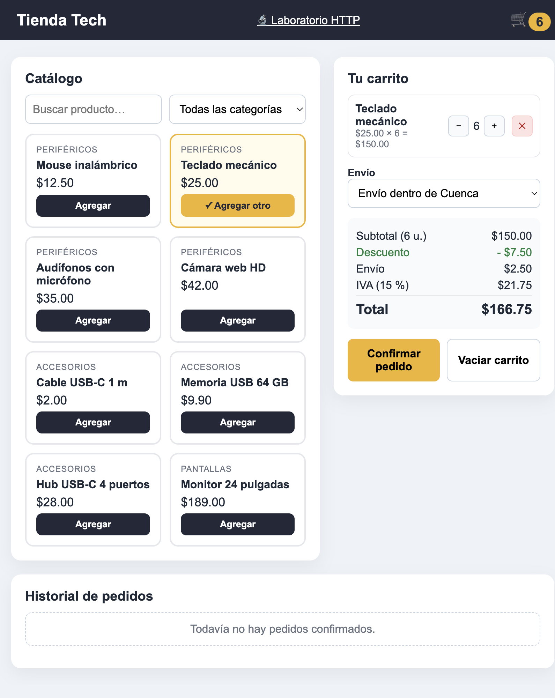
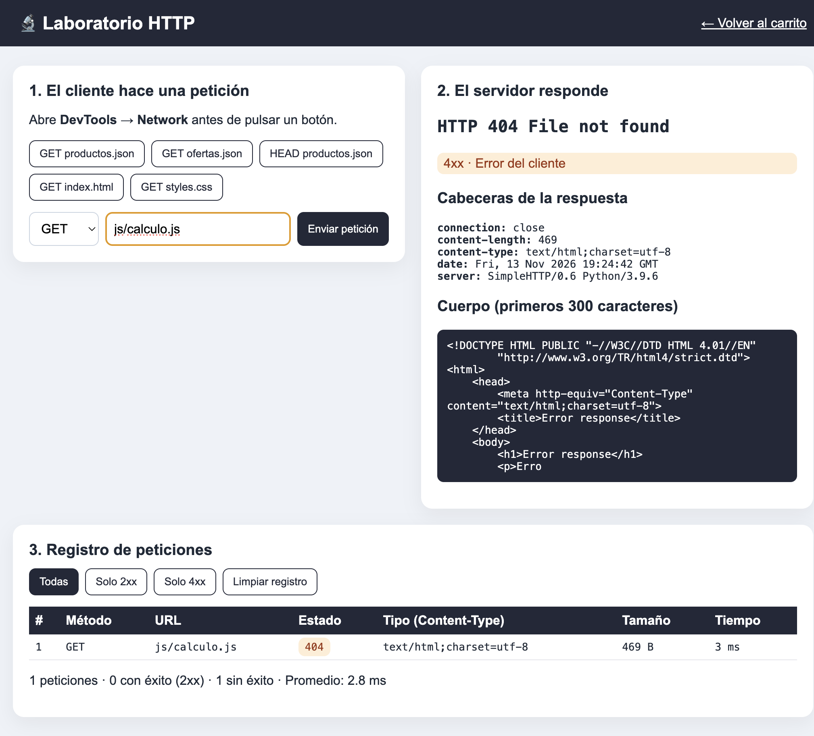
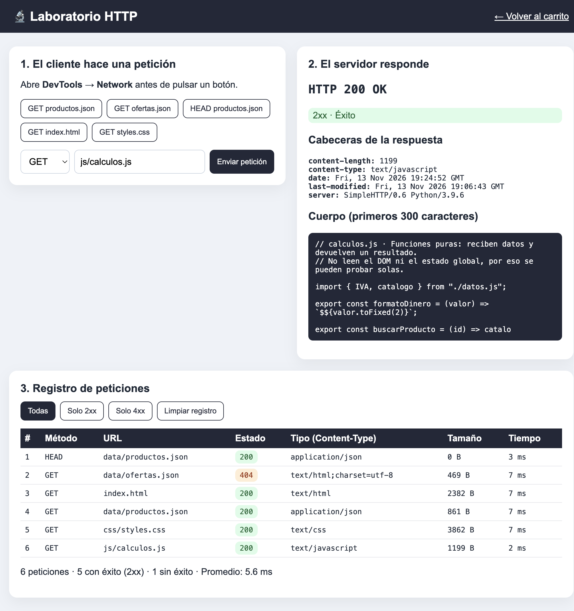

# Programación Web · Semana 06 · Carrito y laboratorio HTTP

**Estudiante:** Andy Ortega  
**Compañero/a:** Andy Ortega

Abre esta carpeta en VS Code y ejecuta `index.html` con **Open with Live Server**. En Chrome, abre DevTools con ⌥⌘I en Mac o F12 en Windows. Usa **Network** para inspeccionar las peticiones y **Console** para ver errores.

## Ficha de los seis casos

| Caso | Procedimiento | Resultado esperado | Observación y evidencia |
| --- | --- | --- | --- |
| 1. Carga normal | Abre Network, activa Disable cache, limpia la lista y recarga. Cuenta los JS por separado y luego revisa All. | La base contiene 9 módulos JS, más el HTML y el CSS. | El carrito cargó correctamente y la captura 1 documenta el estado ejecutado con seis teclados. |
| 2. Caché | Desmarca Disable cache. Recarga normalmente y luego fuerza la recarga con Ctrl+Shift+R o ⌘⇧R. Revisa Status, Size y las cabeceras de un mismo recurso. | En la recarga normal pueden verse 304, memory/disk cache o 200 según el navegador y las cabeceras. | No se registró una comparación reproducible de caché en esta ejecución. |
| 3. Import incorrecto | Cambia temporalmente `"./calculos.js"` por `"./calculo.js"` en `js/main.js`. Guarda, recarga, captura el fallo y restaura el import original. | GET a `js/calculo.js` con 404. | Se observó `HTTP 404 File not found`; la captura 2 muestra la ruta, el estado, `469 B` y `3 ms`. |
| 4. Apertura local | Abre `index.html` con doble clic y revisa Console y la barra de direcciones. | URL `file://`; Chrome puede bloquear los módulos por CORS. | No se ejecutó esta variante porque la práctica se verificó con servidor HTTP local. |
| 5. Laboratorio | Regresa a Live Server, abre el laboratorio y filtra Network por Fetch/XHR. Pulsa los cinco botones y envía GET `js/calculos.js` desde el formulario. | Las seis peticiones coinciden en método, recurso y estado con Network. | Se registraron 6 peticiones: 5 con 200, 1 con 404 y promedio de `5.6 ms`; captura 3. |
| 6. Sitio con HTTPS | Abre el EVA o una tienda en línea. Activa Preserve log y la columna Protocol con clic derecho en los encabezados. Limpia Network, navega y revisa la petición del documento. | Registrar URL inicial y final, número de peticiones, protocolo (http/1.1, h2 o h3), estados de redirección si aparecen y estado de seguridad desde el icono de la barra de direcciones. | Pendiente. Sitio: __. Peticiones: __. Protocolo: __. Redirecciones: __. Conexión segura: __. |

## Caso 5 · Resultados esperados

| Petición o prueba | Resultado |
| --- | --- |
| GET `data/productos.json` | 200, `application/json`, `861 B`; el cuerpo contiene 8 productos. |
| GET `data/ofertas.json` | 404, `text/html;charset=utf-8`, `469 B`. |
| HEAD `data/productos.json` | 200, `application/json`, 0 B de cuerpo. |
| GET `index.html` | 200, `text/html`, `2382 B`. |
| GET `css/styles.css` | 200, `text/css`, `3862 B`. |
| GET `js/calculo.js` | 404. La ruta correcta `js/calculos.js` respondió 200 con `1199 B`. |
| Servidor apagado | Con el laboratorio ya abierto, detén Live Server y pulsa un botón. Se espera «Sin respuesta» y estado —. |
| Seis teclados con envío a Cuenca | Subtotal $150.00, descuento $7.50, envío $2.50, IVA $21.75 y total **$166.75**. El total se verificó ejecutando la función original del carrito. |

## Retos de ampliación

- **Red lenta.** Con Disable cache activado, recarga el carrito con No throttling y repite con Slow 4G. Anota el tiempo de Load y la diferencia. Sin limitación: __ ms. Slow 4G: __ ms. Diferencia: __ ms.
- **Tiempo promedio.** Envía varias peticiones y compara el promedio que aparece en el resumen con la media de los tiempos de las filas. Las filas se redondean a milisegundos enteros.
- **POST.** Selecciona POST y envía la ruta `data/productos.json`. Código observado: __. Un servidor de archivos sirve recursos estáticos y puede rechazar POST porque carece de un controlador que lo procese. El código depende del servidor.
- **Filtros.** Pulsa Solo 2xx, Solo 4xx y Todas. Comprueba que cambian las filas visibles y que el resumen sigue representando todo el historial.

## Capturas para la entrega

Las tres capturas reales están guardadas en `capturas/`.

1. `01-network-carrito.png`: pestaña Network con la carga normal y los estados visibles.
2. `02-modulo-404.png`: petición a `js/calculo.js` con el estado 404 visible.
3. `03-registro-laboratorio.png`: tabla del laboratorio con las seis peticiones y sus resultados.

## Declaración de uso de IA

Usé ChatGPT/Codex para integrar el laboratorio con los módulos de la semana 5, preparar el registro y sus filtros, verificar el cálculo del carrito, ejecutar las pruebas en el navegador y redactar la ficha. Los valores de esta ficha corresponden a la ejecución realizada con un servidor HTTP local.
